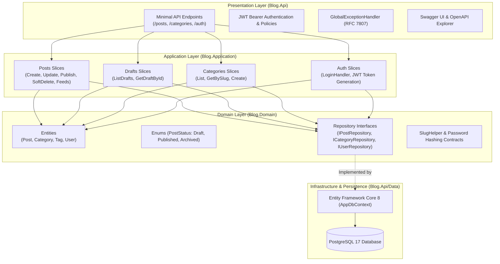

<div align="center">

# 🚀 Dev Portfolio & Headless Blog API

**A modular, high-performance developer portfolio & multilingual blog engine built with .NET 8, Clean Architecture, and PostgreSQL.**

[](https://dotnet.microsoft.com/)
[](https://docs.microsoft.com/en-us/dotnet/csharp/)
[](https://www.postgresql.org/)
[](https://www.docker.com/)
[](https://github.com/features/actions)
[](LICENSE)

[Architecture Decision Records (ADRs)](docs/en/adr/ADR.md) • [OpenAPI Specification](docs/specs/features/openapi.yaml) • [Bruno API Suite](docs/specs/bruno) • [Documentação em Português](docs/pt-BR/README.md)

</div>

---

## 📌 Overview

This repository powers the backend API and headless CMS for my personal developer portfolio and engineering blog. 

Engineered from the ground up to demonstrate **production-grade software engineering patterns**, it avoids monolithic frameworks and bloat in favor of a fast, modular **3-Layer Clean Architecture** with **Vertical Feature Slicing**, single-admin security, and native internationalization (`en-US` and `pt-BR`).

### Key Highlights
* **Pragmatic Clean Architecture**: Strict decoupling across `Blog.Domain`, `Blog.Application`, and `Blog.Api`.
* **Vertical Feature Slices**: Application handlers organized by discrete features rather than shared, bloated service classes.
* **First-Class Multilingual Support (i18n)**: Translation grouping (`TranslationGroupId`) with database-enforced language uniqueness per group.
* **Single-Admin Security**: Salted PBKDF2 hashing with constant-time verification + HMAC-SHA256 JWT Bearer authentication.
* **RFC 7807 Error Handling**: Consistent, machine-readable `ProblemDetails` for 400, 401, 404, 409, and 500 statuses.
* **Production-Safe Migrations**: EF Core Migration Bundles compiled in CI to eliminate container startup migration deadlocks.
* **Living Documentation**: 12 bilingual Architecture Decision Records (ADRs) capturing the exact rationale behind every major design choice.

---

## 🏗️ Architectural Overview



---

## ⚡ Tech Stack & Libraries

| Category | Technology | Usage |
| :--- | :--- | :--- |
| **Runtime & Language** | .NET 8 LTS / C# 12 | Primary application runtime |
| **API Framework** | ASP.NET Core Minimal APIs | Lightweight, zero-overhead HTTP routing |
| **Persistence & ORM** | EF Core 8 / Npgsql | Code-first migrations and PostgreSQL driver |
| **Database** | PostgreSQL 17 | Relational persistence with unique slug indexes |
| **Security** | PBKDF2 + JWT Bearer | 100,000-iteration key derivation + signed Bearer tokens |
| **Testing** | xUnit / FluentAssertions | Domain entity & invariant unit tests |
| **API Testing** | Bruno | Spec-driven, git-friendly API regression collection |
| **CI/CD & DevOps** | GitHub Actions / Docker | Multi-stage caching build + GHCR + Render Deploy Hook |

---

## 📂 Project Structure

```text
├── .github/
│   └── workflows/
│       └── deploy.yml              # CI/CD: build, test, migration bundle, GHCR, Render
├── docs/
│   ├── en/adr/                     # English Architecture Decision Records (ADRs 0001-0012)
│   ├── pt-BR/adr/                  # Portuguese Architecture Decision Records
│   └── specs/
│       ├── bruno/                  # Bruno API collections (Auth, Posts, Categories)
│       └── features/openapi.yaml   # Canonical OpenAPI 3.0 specification
├── src/
│   ├── Blog.Domain/                # Pure enterprise domain: entities, enums, interfaces
│   ├── Blog.Application/           # Vertical slice CQRS handlers & DTO contracts
│   └── Blog.Api/                   # Minimal APIs, EF Core repositories, auth & exception handling
├── tests/
│   └── Blog.Domain.Tests/          # Unit tests for domain rules and SlugHelper
├── Dockerfile                      # Multi-stage build with non-root 'app' user
├── PortfolioBlog.slnx              # Solution definition file
└── README.md                       # Repository entrypoint
```

---

## 🚦 API Endpoints At A Glance

### 🌐 Public Endpoints (Anonymous Access)
* `GET /api/v1/posts` — List published posts (paginated, filterable by `category` and `language`).
* `GET /api/v1/posts/{slug}` — Retrieve published post details with translation group references.
* `GET /api/v1/categories` — List all categories with published post counts.
* `GET /api/v1/categories/{slug}` — Retrieve single category details.
* `POST /api/v1/auth/login` — Authenticate admin and receive Bearer JWT.

### 🔒 Admin Protected Endpoints (`Authorization: Bearer <token>`)
* `POST /api/v1/posts` — Author a new post (supports auto/custom slugs, inline tags, dual category resolution).
* `PUT /api/v1/posts/{id}` — Update post content with SEO slug preservation & collision checks.
* `DELETE /api/v1/posts/{id}` — Soft-delete post (transitions status to `Archived`, returns `204 No Content`).
* `POST /api/v1/posts/{id}/publish` — Transition draft post to `Published`.
* `GET /api/v1/posts/drafts` — Authoring feed of draft posts ordered by latest edit.
* `GET /api/v1/posts/drafts/{id}` — Complete draft details with full Markdown content for previewing.
* `POST /api/v1/categories` — Create curated taxonomy category.

---

## 🚀 Getting Started Locally

### Prerequisites
* [.NET 8 SDK](https://dotnet.microsoft.com/download/dotnet/8.0)
* [Docker Desktop](https://www.docker.com/products/docker-desktop/) or Docker CLI
* [Bruno CLI / App](https://www.usebruno.com/) (Optional, for API testing)

### 1. Clone & Start PostgreSQL
```bash
# Clone the repository
git clone https://github.com/lucasefreitas/dev-portfolio-blog.git
cd dev-portfolio-blog

# Start local PostgreSQL container
docker run -d --name blog-postgres -p 5432:5432 -e POSTGRES_PASSWORD=postgres -e POSTGRES_DB=blog_db postgres:17-alpine
```

### 2. Run Database Migrations & Start the API
```bash
# Apply EF Core migrations to local Postgres
dotnet ef database update --project src/Blog.Api

# Run API with development profile
dotnet run --project src/Blog.Api --launch-profile http
```

The API will start at `http://localhost:5094`. You can explore and test endpoints via Swagger UI at **`http://localhost:5094/swagger`**.

### 3. Run Automated Tests
```bash
dotnet test
```

### 4. Run API Tests via Bruno
1. Open the collection in [`docs/specs/bruno`](docs/specs/bruno) using Bruno.
2. Select the **`local`** environment (`baseUrl: http://localhost:5094`).
3. Run `Auth -> Admin Login` (this automatically captures and stores the Bearer JWT token).
4. Run requests under `Posts` and `Categories`.

---

## 📖 Architecture Decision Records (ADRs)

Every foundational architecture choice is recorded as a dedicated ADR:

| ID | Title | Status |
| :--- | :--- | :---: |
| [ADR-0001](docs/en/adr/0001-adopt-dotnet-8-lts.md) | Adopt .NET 8 LTS as Application Runtime | Accepted |
| [ADR-0002](docs/en/adr/0002-three-layer-clean-architecture.md) | Adopt Pragmatic 3-Layer Clean Architecture | Accepted |
| [ADR-0003](docs/en/adr/0003-secrets-and-environments-configuration.md) | Environment Variables and Secrets Management | Accepted |
| [ADR-0004](docs/en/adr/0004-multilingual-posts-and-slug-strategy.md) | Multilingual Posts and Slug Strategy (i18n) | Accepted |
| [ADR-0005](docs/en/adr/0005-error-handling-and-problem-details.md) | Error Handling and ProblemDetails Strategy | Accepted |
| [ADR-0006](docs/en/adr/0006-adopt-bruno-for-api-testing-and-documentation.md) | Adopt Bruno for API Testing and Documentation | Accepted |
| [ADR-0007](docs/en/adr/0007-post-creation-and-translation-authoring-flow.md) | Post Creation and Translation Authoring Flow | Accepted |
| [ADR-0008](docs/en/adr/0008-category-management-and-authoring-flow.md) | Category Management and Authoring Flow | Accepted |
| [ADR-0009](docs/en/adr/0009-post-update-and-slug-mutation-strategy.md) | Post Update and Slug Mutation Strategy | Accepted |
| [ADR-0010](docs/en/adr/0010-draft-posts-management-and-authoring-feed.md) | Draft Posts Management and Authoring Feed | Accepted |
| [ADR-0011](docs/en/adr/0011-single-admin-jwt-authentication.md) | Single-Admin JWT Authentication Strategy | Accepted |
| [ADR-0012](docs/en/adr/0012-post-deletion-and-soft-delete-strategy.md) | Post Deletion and Soft Delete Strategy | Accepted |

*Para a versão em português, consulte o [Índice de ADRs em Português](docs/pt-BR/adr/ADR.md).*

---

## 📄 License

This project is licensed under the [MIT License](LICENSE).
